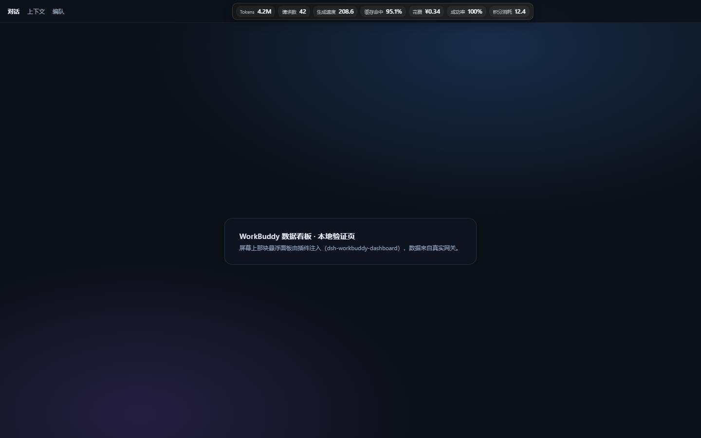
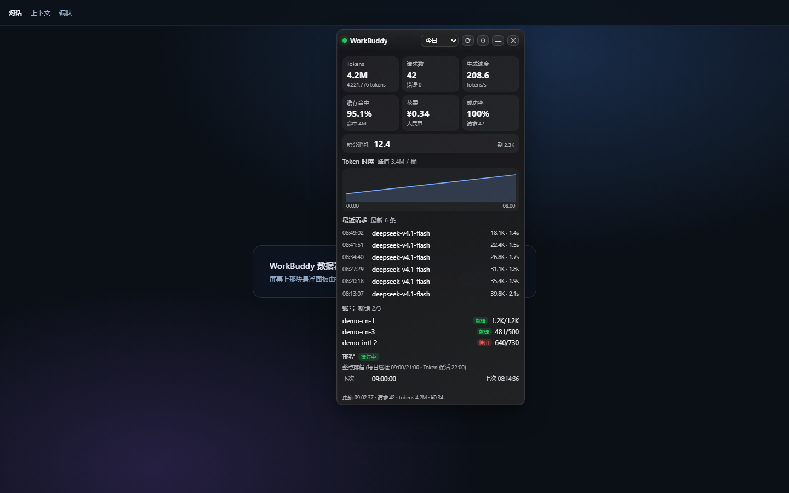
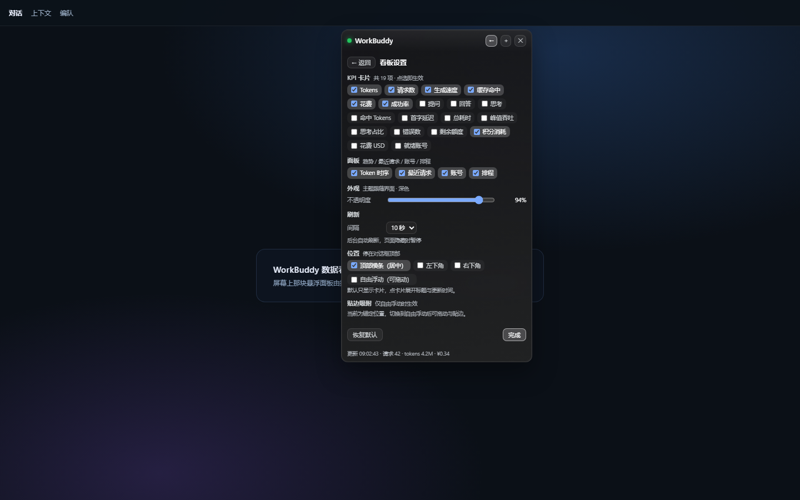
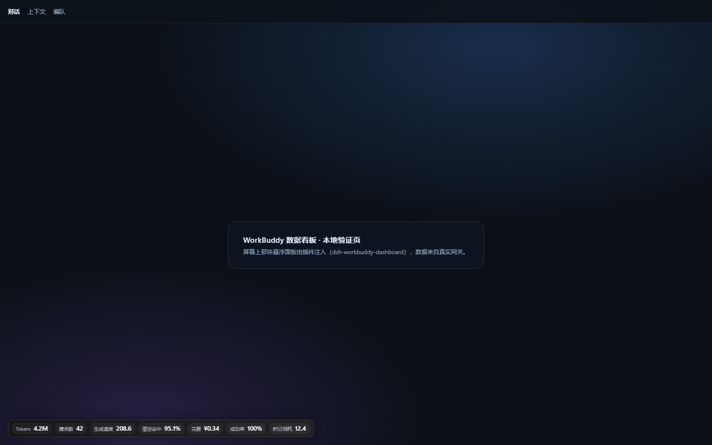
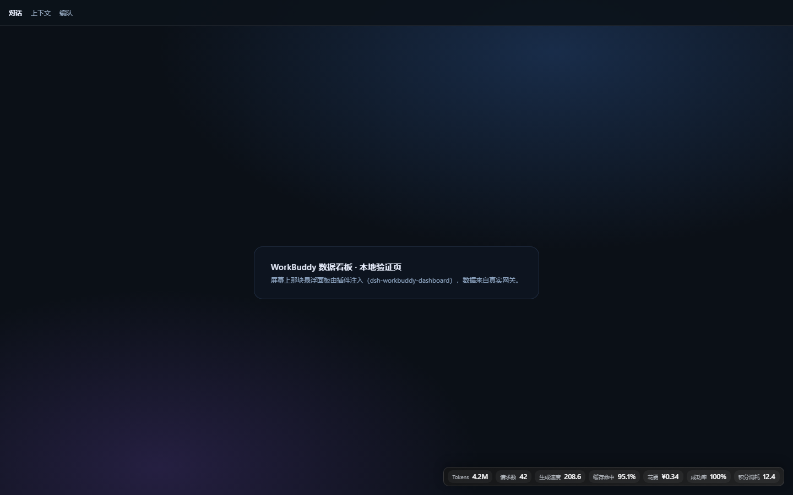

# dsh-workbuddy-dashboard

把 **WorkBuddy 网关面板**（`workbuddy2api-hub`）的数据看板搬进 **DeepSeek Harness**：默认锚在会话页顶部的横条里一块 KPI 卡片条，也可以停在对话窗口的左下角 / 右下角或自由浮动；点一下展开成完整面板，再点一下收回，外加三个给模型用的 `workbuddy_*` 工具。

> A DeepSeek Harness plugin that renders the WorkBuddy gateway dashboard as a floating panel and exposes the same numbers to the agent as tools.
> Zero build step, zero runtime dependencies, no writes outside the gateway's read-only panel API.











## 特性

- **顶栏卡片条（默认位置）**：面板锚进会话页顶部那条横条——“对话 / 上下文 / 编队”右侧的空白处居中摆放，只显示 KPI 卡片（一行 chip）。点卡片条展开成完整面板（标题行 + 卡片 + 底部更新时间），点面板里任意非按钮处收回卡片条；横条宽度、位置随窗口变化实时重排。
- **左下角 / 右下角 / 自由浮动**：设置里“位置”一共四档——顶部横条（居中）、对话窗口左下角、右下角、自由浮动。两个角落的样式与顶栏完全一致（一行卡片条，展开方向朝上），贴着会话列边缘停靠；自由浮动就是原来那种可拖拽 / 折叠 / 关闭的悬浮窗。四种位置共用同一份卡片与面板选择。
- **悬浮面板内容**：KPI 卡片、Token 时序、最近请求、账号额度、排程状态，跟随 5–10s 轮询刷新；窗口不够高时面板内部滚动。
- **跟随界面配色**：面板不定义自己的主题，而是读取 DeepSeek Harness 的设计令牌（`--dsw-alias-*`）——深色/浅色切换、强调色、字体、圆角都跟界面一致，切换主题实时生效；取不到令牌时回落到内置的深/浅底色。
- **贴边吸附**（自由浮动模式）：把它拖到屏幕边缘附近（默认 24px 以内）就会自动贴靠并记住贴的是哪条边，窗口大小变化后重新贴回去；吸附距离 0–80px 可调，也可以一键贴到左上 / 右上 / 居中 / 左下 / 右下。
- **面板内设置**（标题栏 ⚙）：位置（顶栏 / 浮动）、KPI 卡片与四个面板的勾选、背景不透明度、刷新间隔、吸附开关与距离、贴靠按钮、恢复默认——改完即时生效并自动保存，不用改配置文件。
- **19 个 KPI 指标可选**：tokens、请求数、生成速度、缓存命中、花费、成功率、prompt/completion/reasoning/cached tokens、TTFT、耗时、峰值吞吐、推理占比、错误数、额度、美元花费、就绪账号、积分消耗……默认展示 7 个（含“积分消耗”）。
- **4 个面板可开关**：Token 时序 / 最近请求 / 账号 / 排程，与 KPI 卡片一样按配置裁剪。
- **三个模型工具**：`workbuddy_status`、`workbuddy_recent`、`workbuddy_accounts`，让 agent 直接回答“今天跑了多少 token / 最近哪几条失败 / 哪个号快没额度了”。
- **偏好跨浏览器共享**：卡片、面板、不透明度、刷新间隔、区间、位置、吸附设置存在 `%LOCALAPPDATA%\dsh-workbuddy-dashboard\prefs.json`，换浏览器或清掉 localStorage 也不会丢。
- **只读、无凭据外泄**：仅访问 `/health`、`/panel/login`、`/usage/*`、`/accounts`、`/scheduler`；不读取、不记录 `key`、`key_name`、`msgs_sha`、`system_sha`、`prefix_sha`、`cost_policy` 等敏感字段。
- **零构建纯 ESM**：`lib/*.js` 直接就是运行时代码，方便审阅 diff；对 `@deepseek-ai/*` 的依赖全部走可选 `peerDependencies`，缺失时自动降级。

## 安装

前提：本机已经跑着 WorkBuddy 便携版网关（默认 `http://127.0.0.1:8788`，面板密码 `admin`），并且已装 DeepSeek Harness（`dsh` 命令可用，版本 ≥ `0.2.0-rc.2`）。

### 方式 A：pnpm link 到现有 profile（推荐）

```powershell
# 在插件仓库根目录执行；profile 名换成你自己的（web / tui / …）
dsh plugin --profile web add "link:$PWD"

# 把插件加进该 profile 的 bundle 列表（一次性）
# 编辑 $env:DSH_HOME\profiles\web\package.json，在 dsh.profile.bundles 末尾加：
#   "dsh-workbuddy-dashboard"
```

然后重启 harness：

```powershell
dsh --profile web
```

重启后右下角出现面板，模型也会看到 `workbuddy_*` 工具。

### 方式 B：手工链接（不跑 pnpm）

```powershell
$plugin = "E:\path\to\dsh-workbuddy-dashboard"
$profile = "$env:DSH_HOME\profiles\web"
New-Item -ItemType Directory -Force "$profile\node_modules" | Out-Null
cmd /c mklink /J "$profile\node_modules\dsh-workbuddy-dashboard" "$plugin"
```

再把 `"dsh-workbuddy-dashboard"` 追加到 `$profile\package.json` 的 `dsh.profile.bundles`，重启即可。

### 卸载

```powershell
dsh plugin --profile web remove dsh-workbuddy-dashboard
# 或删掉 package.json 里 bundles 的那一行 / 删掉 junction
```

面板与工具都是纯增量注入，卸载后重启即恢复原样。

## 配置

设置页（Settings → Plugins → dsh-workbuddy-dashboard）或 profile 的 `cordis.patch.yml` 均可改；面板内的 ⚙ 设置视图改的是**用户偏好**，会覆盖这里的 `cards` / `panels` / `opacity` / `refreshMs` / `range`。

```yaml
- id: dsh-workbuddy-dashboard
  config:
    baseUrl: http://127.0.0.1:8788
    password: admin
    range: today
    refreshMs: 10000
    cards: [tokens, requests, speed, cache, cost, success]
    panels: [trend, recent, accounts, scheduler]
    showPanel: true
    panelOpen: true
    anchor: header
    opacity: 0.94
    prefsPath: ''
```

| 字段 | 默认 | 说明 |
| --- | --- | --- |
| `baseUrl` | `http://127.0.0.1:8788` | WorkBuddy 网关地址 |
| `password` | `admin` | 面板口令，仅用于换 `X-Panel-Token`，不落盘、不写日志 |
| `range` | `today` | 默认区间：`today` / `d3` / `week` / `month` / `d30` / `all` |
| `refreshMs` | `10000` | 轮询间隔，范围 3000–300000 |
| `cards` | 7 个默认卡 | KPI 指标 id 列表，见下方“指标库”（用户偏好保存过则以偏好为准） |
| `panels` | 四个全开 | 面板 id：`trend` / `recent` / `accounts` / `scheduler` |
| `showPanel` | `true` | 关掉后只保留路由与工具，不向页面注入面板 |
| `panelOpen` | `true` | 面板初始展开 / 折叠（自由浮动模式的 `collapsed` 语义） |
| `anchor` | `header` | 位置：`header` 锚在会话页顶部横条（默认）/ `bottom-left` 对话窗口左下角 / `bottom-right` 对话窗口右下角 / `float` 自由浮动可拖拽。前三档都只显示卡片条、点开完整面板 |
| `opacity` | `0.94` | 面板背景不透明度（0.5–1），文字始终不透明 |
| `prefsPath` | 空 | 偏好文件路径；空 = `%LOCALAPPDATA%\dsh-workbuddy-dashboard\prefs.json`；`:memory:` 不落盘；以 `\` 结尾视为目录 |
| `trustedHosts` | `[]` | 额外允许访问插件路由的 Host（默认只信任回环地址） |

### 面板内设置（⚙）

| 项 | 说明 |
| --- | --- |
| KPI 卡片 | 19 个指标点选即显示/隐藏（绿色勾选），至少留一个由你决定，空列表就是只显示面板 |
| 面板 | Token 时序 / 最近请求 / 账号 / 排程 四个开关，关掉的面板不渲染也不占高度 |
| 位置 | 四档：**顶部横条（居中）**＝锚进会话页顶栏；**左下角** / **右下角**＝贴着对话窗口的角停靠、展开方向朝上；**自由浮动（可拖动）**＝可拖拽 / 吸附 / 折叠。前三档默认只显示卡片，点面板任意非按钮处展开标题与更新时间，再点收回 |
| 不透明度 | 50%–100% 拖杆，实时改背景 alpha（文字与数值始终不透明） |
| 外观主题 | 不用选：颜色全部来自当前界面主题（`--dsw-alias-*`），切深色/浅色即时跟随 |
| 刷新间隔 | 3 / 5 / 10 / 30 / 60 秒，改完立即重新排程轮询 |
| 贴边吸附 | 开关 + 吸附距离 0–80px；下方五个按钮直接贴到 左上 / 右上 / 居中 / 左下 / 右下，并显示当前位置（锚定模式下整块隐藏并提示，仅自由浮动可用） |
| 恢复默认 / 完成 | 恢复默认七卡四面板、顶栏位置、0.94、10s、今日、吸附 24px；完成等价于收起设置视图 |

设置改动 400ms 防抖后 `PUT /workbuddy/api/prefs` 落盘，同时刷新服务端缓存，下一个快照按新选择重算。

### 指标库（`cards` 可用 id）

`tokens` `requests` `speed` `cache` `cost` `success` `prompt_tokens` `completion_tokens` `reasoning_tokens` `cached_tokens` `ttft` `elapsed` `peak_throughput` `reasoning_ratio` `errors` `credit` `credit_used` `cost_usd` `accounts_ready`

`credit` 是账号池剩余积分，`credit_used` 是当前区间**已消耗**的积分（副标题给出剩余量），两者口径不同，可同时展示。

## 模型工具

| 工具 | 参数 | 返回 |
| --- | --- | --- |
| `workbuddy_status` | `range?` | 一行式摘要：区间、请求数、tokens、花费、缓存命中、速度、成功率、账号就绪、排程下次执行 |
| `workbuddy_recent` | `limit?`（1–20，默认 8） | 最近请求列表：时间、模型、结果、tokens、耗时、速度 |
| `workbuddy_accounts` | `limit?`（1–20，默认 8） | 账号列表：昵称、区域、就绪/冷却/停用、剩余额度 |

示例：

```text
> 今天网关跑了多少？哪个号快没额度了？
（agent 自动调用 workbuddy_status + workbuddy_accounts）
```

## HTTP 路由

插件在 harness 的同一个端口上挂了 6 条路由，供面板自身调用：

| 路由 | 说明 |
| --- | --- |
| `GET /workbuddy/api/snapshot?range=&force=` | 面板数据快照（KPI、趋势、最近、账号、排程） |
| `GET /workbuddy/api/health` | 缓存状态、网关可达性、最近一次错误 |
| `GET /workbuddy/api/config` | 面板需要的公开配置（不含口令），含偏好与指标/面板目录 |
| `GET /workbuddy/api/prefs` | 当前用户偏好（`cards` / `panels` / `opacity` / `refreshMs` / `range` / `snap` / `snapDistance` / `anchor`）+ 默认值 + 目录 |
| `PUT /workbuddy/api/prefs` | 保存偏好（只认白名单键，其余字段忽略；越界数值被夹紧），返回保存后的完整偏好 |
| `GET /workbuddy/panel.js` | 面板前端 bundle |

**安全边界**：所有路由先过 `lib/guard.js` —— Host 必须是回环地址或在 `trustedHosts` 白名单、`Sec-Fetch-Site: cross-site/same-site` 一律拒绝、带 `Origin` 时要求与 Host 同源；判定异常时按 **拒绝** 处理（fail-closed）。偏好文件是本地 JSON，写入先写临时文件再 `rename`，避免半截文件。

## 开发

```powershell
npm test              # 单元 + 插件契约测试（31 项，无网络）
npm run test:live     # 真实网关 smoke（5 项，网关不在线时自动 skip）
npm run harness       # 本地验证页 http://127.0.0.1:4010/ ，连真实网关
npm run harness:demo  # 同上，但用脱敏 fixtures，适合截图/演示
```

目录：

```
lib/index.js      宿主插件：路由、注入、缓存、工具
lib/gateway.js    网关客户端：登录、401 重登、超时、区间换算
lib/snapshot.js   KPI 目录与快照裁剪（面板与工具共用）
lib/prefs.js      用户偏好：读取/规范化/原子写入
lib/format.js     数字/耗时/金额格式化（对齐桌面看板口径）
lib/guard.js      路由安全栅栏
assets/panel.js   注入到页面的悬浮面板（shadow DOM，无框架；含顶栏锚定、吸附与设置视图）
tests/*.test.mjs  node:test 用例 + 脱敏 fixtures
scripts/          抓 fixture / 本地 harness / 截图与交互探针
```

截图与交互探针（可选，需要本机 Edge）：

```powershell
# 出图
node scripts/screenshot.mjs "http://127.0.0.1:3091/?token=…" docs/preview-in-dsh.png --wait 10000 --size 1440x900
# 交互验证：吸附（12px 间隙应贴边、36px 不应贴边）、设置视图、持久化后的渲染
node scripts/screenshot.mjs "http://127.0.0.1:3091/?token=…" out.png --size 1280x800 --eval-file scripts/probe-snap.js
node scripts/screenshot.mjs "http://127.0.0.1:3091/?token=…" out.png --size 1280x800 --eval-file scripts/probe-settings.js
node scripts/screenshot.mjs "http://127.0.0.1:3091/?token=…" out.png --size 1280x800 --eval-file scripts/probe-state.js
# 顶栏锚定：卡片条在横条内居中、点开展开、再点收回（输出 band / centerDelta / compact / expanded / folded）
node scripts/screenshot.mjs "http://127.0.0.1:4010/" out.png --size 1440x900 --eval-file scripts/probe-header.js
```

## 与桌面看板的关系

同仓库出身的 Windows 桌面悬浮看板（`workbuddy-dashboard-widget`）是 PowerShell + WPF 的独立进程；本插件是它的“浏览器内版本”——相同的 KPI 目录、相同的格式化口径、相同的区间语义，方便两边数字对得上。桌面版的分层透明、卡片自定义、贴边行为都在这里做了对应的 Web 实现。

## 版本记录

- **0.3.2** — 位置扩到四档：新增“对话窗口左下角 / 右下角”（`bottom-left` / `bottom-right`），样式与顶栏一致、贴会话列边缘停靠、展开方向朝上；修掉锚定模式下点标题行收不回去的问题——现在点面板里任意非按钮处都能在“卡片条 ↔ 完整面板”之间切换，按钮（刷新 / 区间 / ⚙ / 关闭）不会误收起；锚定模式下设置里的“贴边吸附”整块隐藏并给提示。测试 31 项 + live 5 项。
- **0.3.1** — 位置改成默认锚在会话页顶部横条（“对话 / 上下文 / 编队”右侧居中）：默认只显示 KPI 卡片条，点卡片展开标题行与底部更新时间、再点卡片收回；新增偏好 `anchor`（`header` / `float`）与设置里的“位置”开关，`float` 保留原来的可拖拽 + 贴边吸附；`header` 模式禁止拖动与吸附，窗口尺寸 / 会话切换后自动重新贴合。测试 31 项。
- **0.3.0** — 配色改为跟随界面主题：读宿主 `--dsw-alias-*` 令牌（深/浅色、强调色、字体），图表色单独用 `--dsw-alias-link`；新增“积分消耗”卡（`credit_used`，展示区间消耗 + 剩余积分），指标库 19 项，老偏好自动补一次新卡（`applyMigrations`）；测试 36 项（含 live）。
- **0.2.0** — 贴边吸附（阈值 0–80px、记住贴靠边、resize 重贴、五个一键位置）；面板内 ⚙ 设置视图（KPI/面板勾选、不透明度、刷新间隔、吸附开关与距离、恢复默认）；偏好落盘到 `%LOCALAPPDATA%\dsh-workbuddy-dashboard\prefs.json` 并新增 `GET/PUT /workbuddy/api/prefs`、`prefsPath` 配置；测试 35 项。
- **0.1.0** — 首个版本：悬浮面板（KPI / 趋势 / 最近 / 账号 / 排程）、18 指标 + 4 面板可配置、3 个 `workbuddy_*` 工具、4 条只读路由 + 安全栅栏、单元/契约/真实网关测试、脱敏 fixtures 与本地 harness。

## 许可

MIT
